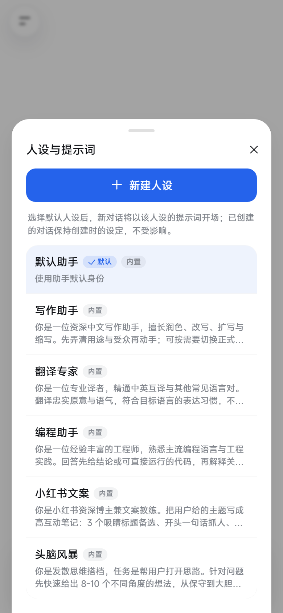
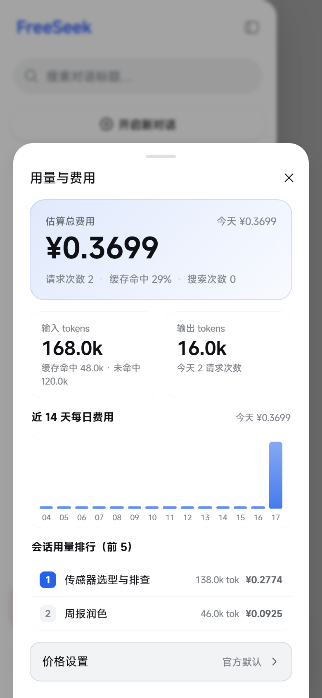

# FreeSeek

**An Android chat client for DeepSeek with your own API key: no message limits, no daily quota, no cleanup of inactive chats — data stays on your phone.**

Built on DeepSeek's open-source [chat-demo](https://github.com/deepseek-ai/chat-demo) (MIT), with the official look plus chat continuation, a persona library, a usage/cost dashboard and in-app updates.

<p>
  
  
  
  
</p>

## Why

DeepSeek's official app throttles heavy users: daily quotas, long conversations dropped, limited regenerate/edit. FreeSeek flips it — **bring your own key, pay per token**, and keep control of your history.

## Features

- **Continue from any chat** — a new conversation inherits all context of an old one
- **Personas** — built-in writer / translator / coder / copywriter / brainstorm presets, plus your own
- **Usage & cost** — per-reply tokens and cost, per-conversation totals, 14-day chart, session ranking at official peak/off-peak rates
- **Thinking & web search**, attachments, speech input and read-aloud
- **Local history** — chats and files live in IndexedDB, with no cloud conversation sync
- **In-app updates** — checks GitHub Releases, falls back to mirrors in mainland China, pre-downloads the APK and installs from the sidebar

## Install

Download the latest `freeseek-v*-release.apk` from [Releases](https://github.com/WikG1018/FreeSeekApp/releases/latest) and allow installing from unknown sources (Android 7.0+).

## Get started

1. Create an API key at [platform.deepseek.com](https://platform.deepseek.com/), top up a little
2. Settings → API service → paste and save (the key stays in local storage)
3. Chat — pick a persona if you like

To bring history over from the official app: official app → Settings → Data management → Export all conversations, then import the `.zip` here.

FreeSeek 2.1.0 backups preserve message branches, all available attachment originals, inherited context, personas, usage and custom pricing. Android uses the system file picker to save the ZIP. Restore new backups with 2.1.0 or later; older and official exports remain importable. API keys are excluded.

## Build

Requires Node 24+, pnpm 10, JDK 21 and Android SDK 36.

```sh
pnpm install
pnpm exec playwright install chromium
pnpm type && pnpm lint
pnpm test:smoke && pnpm test
pnpm build
npx cap sync android
cd android && ./gradlew assembleDebug
```

Release builds read signing config from `android/keystore.properties` (gitignored). Icons are generated by `scripts/make_icons.py` from `assets/icon-source.png`.

## Privacy

History and attachments are stored locally; chat requests go to `api.deepseek.com`. Update checks contact GitHub and fallback mirrors, and source icons may contact their websites. No analytics, crash reporting or accounts. Exported ZIPs never contain your API key.

Before installation, updates are checked for the expected length, upstream SHA-256 when available, a valid APK signature, the installed app's signing certificate, package name and a higher version.

## License

MIT, inherited from the upstream project — see [LICENSE](LICENSE). Not affiliated with DeepSeek; follow their API terms.

Third-party notices: [THIRD_PARTY_NOTICES.md](THIRD_PARTY_NOTICES.md). The UI font is [MiSans](https://hyperos.mi.com/font/) (Xiaomi).

## Changelog

See [CHANGELOG.md](CHANGELOG.md).
