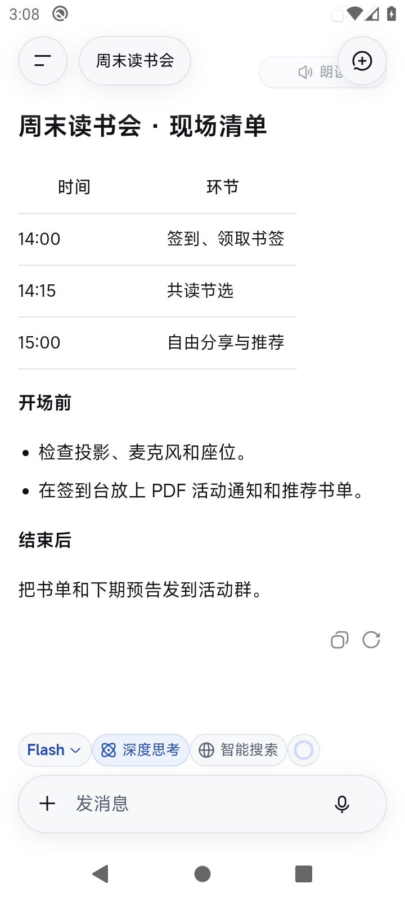
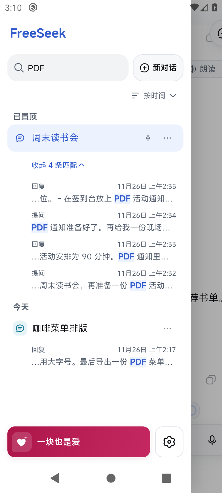
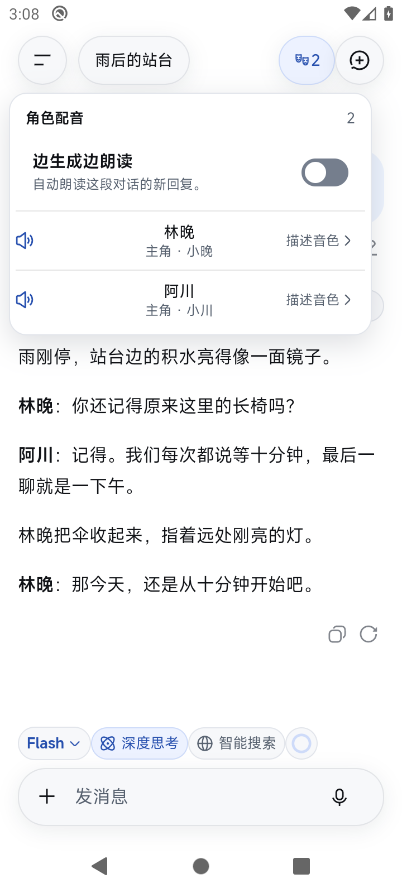
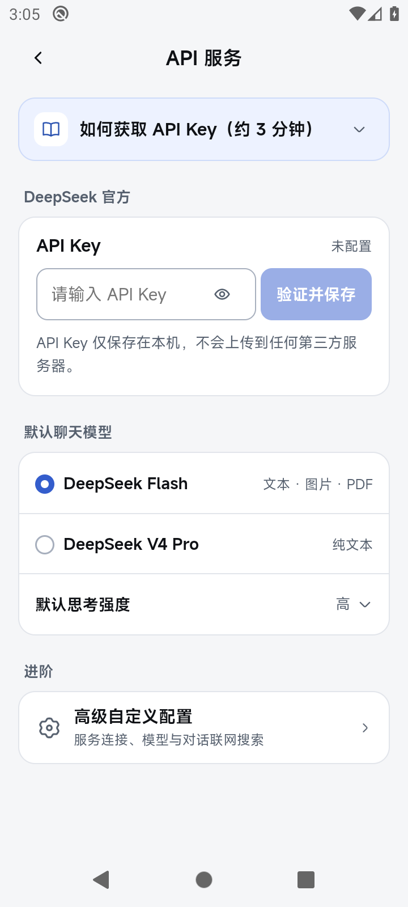
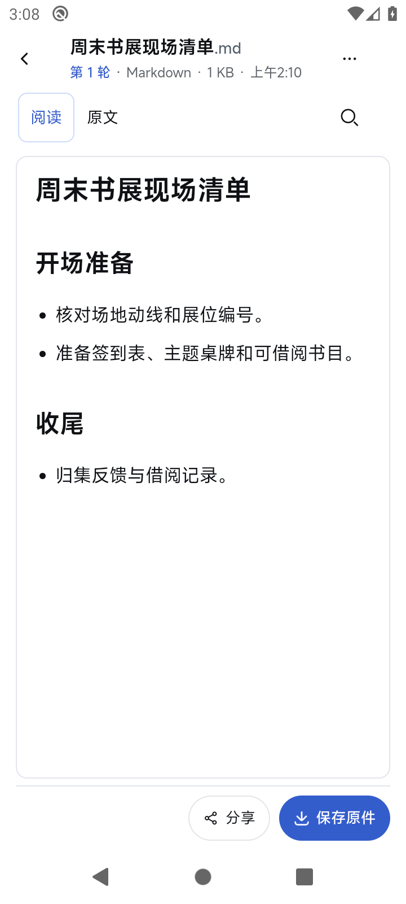
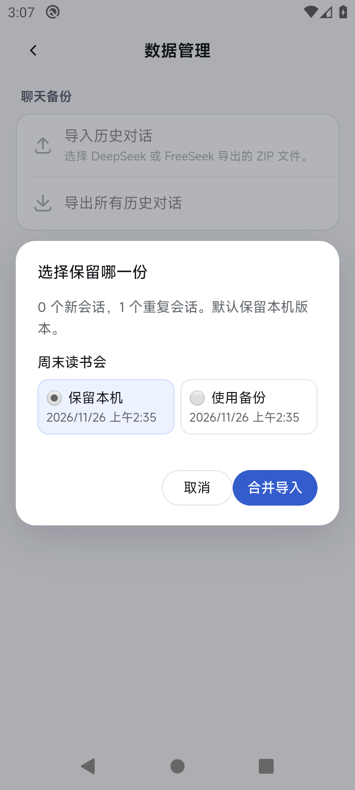
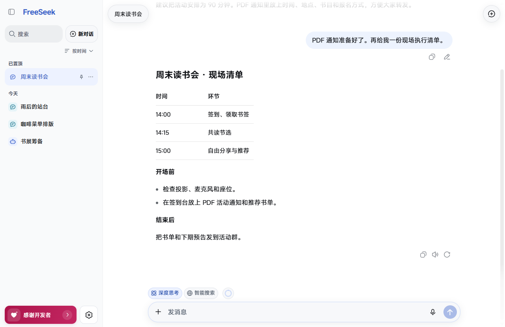

# FreeSeek

[简体中文](README.md) · [Download](https://github.com/WikG1018/FreeSeekApp/releases/latest) · [Open the web app](https://wikg1018.github.io/FreeSeekApp/) · [User guide](docs/guides/user-guide.en.md)

FreeSeek is an open-source chat client for Android, Windows, and the web. Connect DeepSeek or another supported model service with your own API key. Chats and attachments are stored in the current app or browser and can be moved using ZIP backups.

 

## Get FreeSeek

| Platform | How to open |
| --- | --- |
| **Android** | Download `freeseek-v…-release.apk` from the [latest release](https://github.com/WikG1018/FreeSeekApp/releases/latest). Allow your installer to install the APK if prompted. The minimum is Android 7.0, with Android 10–17 as the main compatibility target. |
| **Windows** | Download `freeseek-v…-windows-x64-setup.exe` from the [latest release](https://github.com/WikG1018/FreeSeekApp/releases/latest). Open FreeSeek from Start after installing. |
| **Web** | [Open FreeSeek](https://wikg1018.github.io/FreeSeekApp/) in a browser. The model endpoint must allow cross-origin requests. |
| **iPhone / iPad** | Open the same website in Safari and [add it to your Home Screen](docs/guides/user-guide.en.md#install-and-update). |

Install updates over the existing app to keep its local data. Export a backup under Settings → Data management before moving devices, reinstalling, or clearing storage. [Installation, checksums, and updates](docs/guides/user-guide.en.md#install-and-update)

## Get started

1. **Chat with DeepSeek.** Go to Settings → API service. Follow the setup steps at the top, enter your API key, verify and save it, then select Flash or V4 Pro.
2. **Connect another service.** Open the advanced custom configuration at the bottom of API service. Enter the endpoint, key, and model. A connection can contain multiple models.
3. **Read your existing chats.** Choose **Bring my old chats here** on first launch or import a DeepSeek or FreeSeek ZIP under Settings → Data management. Importing and reading existing conversations requires no API key.

[Connect a model](docs/guides/user-guide.en.md#connect-a-model) · [Back up and restore](docs/guides/user-guide.en.md#backup-import-and-restore)

## Features

| What you can do | Where to find it |
| --- | --- |
| **Change models, thinking, and search** | Configure DeepSeek or a custom provider in API service. Enable model and thinking controls in Chat preferences. With Smart search enabled, compatible models can search when needed and cite sources. |
| **Search and organize chats** | Search titles and messages in the sidebar, expand multiple matches in a conversation, and jump to each one. Pin chats, sort by date or type, edit prompts, and switch reply versions. |
| **Work with long conversations** | The ring beside the composer shows estimated context use. Compress older turns from a conversation's menu, or enable automatic compression in Chat preferences. |
| **Read attachments and results** | Use the composer’s plus button to attach files or photos. Supported inputs depend on the model. Zoom into images and preview supported PDF, Word, Excel, PowerPoint, and 3D results. |
| **Use voice and character voices** | Transcribe microphone input or play a reply aloud. Set up Xiaomi MiMo and choose Character voices in Chat preferences to give narration and characters separate voices. |
| **Use personas, memory, and agents** | Manage personas and automatic memory in Settings. Enable Agent on Android or the web for multi-step tasks and file creation. Available tools and background behavior depend on the platform. |
| **Review usage and time** | Usage & cost shows tokens, cache hit rates, and estimated charges by chat and model. Screen time shows activity and conversation rankings. |
| **Move chats and report issues** | Back up or merge chat history in Data management. Choose which copy to keep when a conversation is duplicated. Save or share diagnostics from About FreeSeek. |

## Screenshots

Screenshots show the FreeSeek v3.1.11 Android and Windows release builds with sample conversations. Open an image for the full-resolution view.

| Android chat | Message search | Character voices |
| :---: | :---: | :---: |
|  |  |  |

| API service | Agent results | Merge import |
| :---: | :---: | :---: |
|  |  |  |

*Conversation and sidebar on Windows*

## Documentation and feedback

- [User guide](docs/guides/user-guide.en.md) covers installation, providers, chats, speech, backups, troubleshooting, and data storage.
- [Build and development](docs/guides/development.md) lists commands for the web app, Android, and Windows.
- [Changelog](CHANGELOG.en.md) records release changes. You can also read the current release notes under About FreeSeek.
- [Report an issue](https://github.com/WikG1018/FreeSeekApp/issues/new) with your platform, version, and reproduction steps. Review any diagnostic bundle before sharing it.

## License

FreeSeek is an independent client based on [DeepSeek chat-demo](https://github.com/deepseek-ai/chat-demo), released under the [MIT license](LICENSE). See the [third-party notices](THIRD_PARTY_NOTICES.md) and [MiSans font license](docs/fonts/MiSans-License.pdf).
