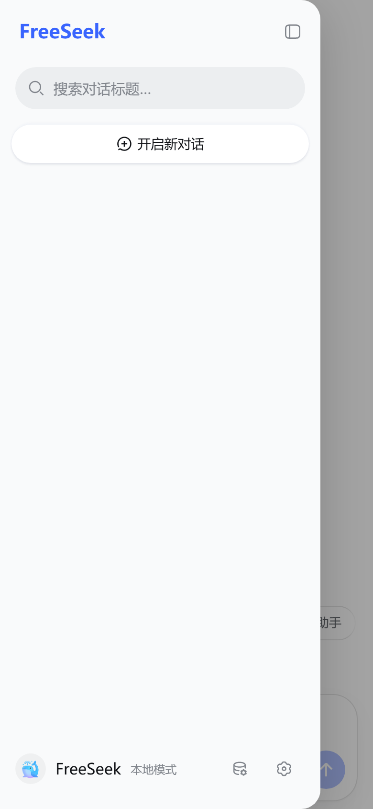
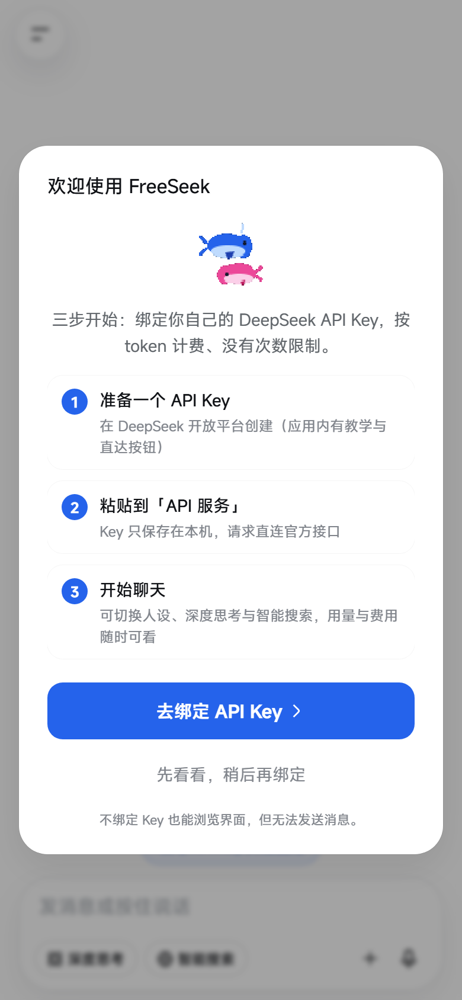
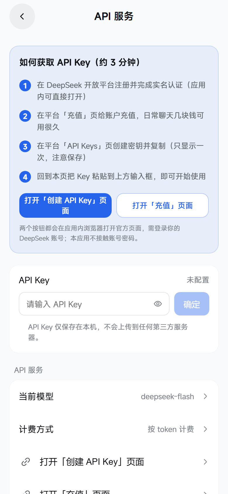
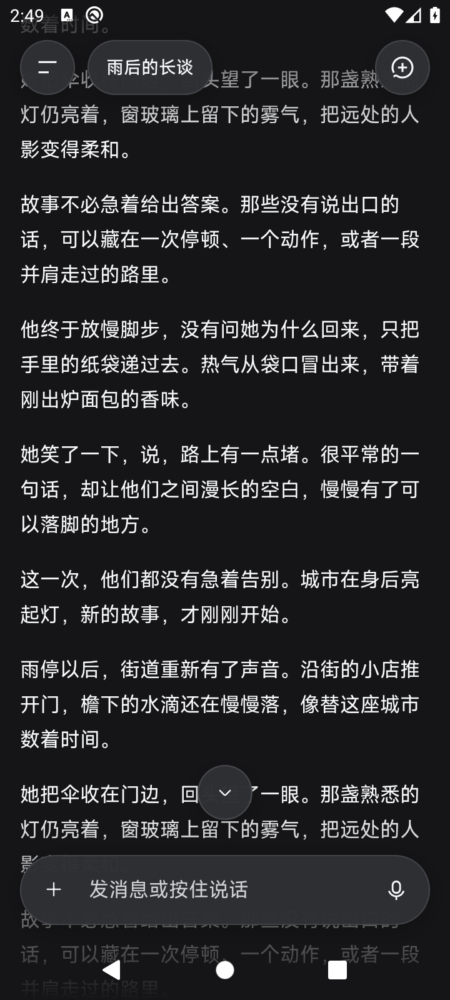
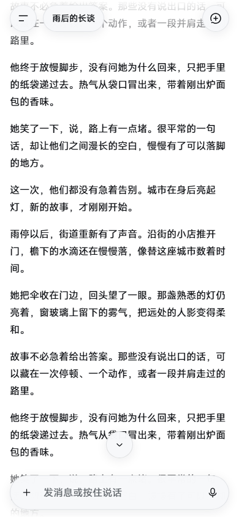
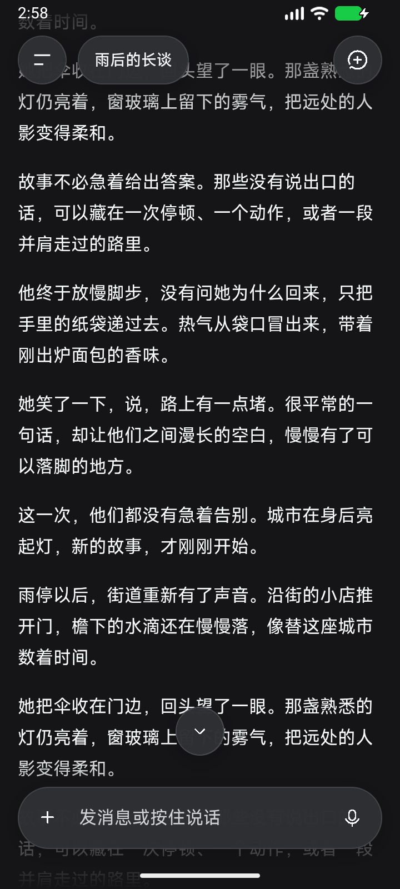

# FreeSeek 畅聊

**自带 API Key 的安卓聊天客户端：支持 DeepSeek 与兼容 API，自主管理模型，对话与附件保存在本机。**

[](https://github.com/WikG1018/FreeSeekApp/releases) [](https://github.com/WikG1018/FreeSeekApp/releases/latest) [](LICENSE)

基于 DeepSeek 官方开源的 [chat-demo](https://github.com/deepseek-ai/chat-demo)（MIT）二次开发，界面延续官方风格，另加对话接续、人设库、用量费用看板与应用内更新。

<p>
  
  
  
  
</p>
<p>
  
  
  
  
</p>

## 为什么做这个

DeepSeek 官方 App 在算力紧张时会限制使用：每日额度、长对话不再支持、修改与重新生成的次数被卡住。FreeSeek 换个思路——**你自己带 Key，按 token 付费**，把是否继续、改几次、留多久的权力拿回自己手里。

- 不设次数上限：重新生成、修改提问都不拦
- 会话永久保存在本机 IndexedDB，不活跃也不会被清
- 数据随时导出 ZIP，换机可恢复

## 功能

Android 聊天页铺满屏幕，正文和侧边栏延伸到状态栏、导航栏背后。菜单与输入框按实际安全区避让，正文通过工具行后继续向屏幕底边渐隐，悬浮输入框使用实底。打开「＋」附件菜单时保留软键盘和光标。输入、附件或大字号展开时会自动调整末条消息的留白。[观看聊天底栏滚动效果](docs/screenshots/floating-dock-v2.6.1.mp4)

手机主界面中部右滑可打开侧边栏，左滑收起，拖动与主界面过渡同步。对话更多菜单支持置顶/取消置顶；底部左侧打赏、右侧设置齿轮，用量统计从设置进入。[观看 Android 17 模拟器滑动实录（5 秒）](docs/screenshots/immersive-drawer.mp4)

<p>
  
  
</p>

Android 10–17 兼容目标：使用 compileSdk/targetSdk 37，保留旧 WebView 兼容层。构建使用 JDK 21、AGP 9.2.1 与 Gradle 9.4.1。运行验证和具体边界见 [Android 10–17 自审记录](docs/reviews/2026-11-17-android10-17.md)、[模型与导入验收](docs/reviews/2026-11-18-models-personas-share.md)、[2.5.0 界面验收](docs/reviews/2026-11-18-ui-navigation.md)、[2.6.0 正式版验收](docs/reviews/2026-11-18-v2.6.0-release.md)及 [2.6.1 输入区与键盘验收](docs/reviews/2026-11-18-v2.6.1-release.md)，系统版本覆盖不等同于全部厂商实机验收。

文字草稿在本机自动保存，重启后可继续输入；未发送附件需要重新选择。录音/朗读在应用进入后台时停止。备份 JSON 分块解析，支持超过旧版 32MiB 限制的官方长会话；单条解压记录上限 128MiB，并限制结构复杂度，附件仍分块处理。导入时显示进度，完整校验并暂存成功后才替换原数据，失败保留原记录。

可在 **设置 → 对话偏好 → 对话中显示 Token 与费用** 关闭对话中的用量显示，选择会在本机保存。用量记录和统计页继续保留；回复末尾不再显示附件未读取说明。

| 功能 | 说明 |
| --- | --- |
| 模型与第三方 API | API 服务页选择 Flash/V4 Pro；高级页可保存多个服务、获取模型、发送短消息测试，支持 OpenAI Chat Completions、Responses、Anthropic Messages、Gemini |
| 对话内模型切换 | 设置 → 对话偏好 → 在对话框显示模型切换按钮，默认关闭；切换影响后续请求 |
| 对话接续 | 任意会话菜单选「从这里继续」，新对话自动携带它之前的上下文 |
| 人设与提示词库 | 自建/编辑、复制内置、搜索、JSON/TXT/Markdown 导入、JSON 导出、设为默认或应用到当前对话；续写保留原人设 |
| 用量与费用 | 每条回复的 token 与花费、会话累计、近 14 天图表、会话排行；单价按官方刊例（区分高峰/空闲） |
| 深度思考 / 智能搜索 | 与官方一致的开关，搜索结果带来源与引用 |
| 附件与文件 | 图片、文档、PDF 等，上传即进入对话上下文 |
| 语音 | 语音输入（ASR）与朗读（TTS），Android 端已适配权限 |
| 本机存储 | 会话和附件保存在本机，不提供云端会话同步 |
| 应用内更新 | 侧边栏提示新版本，点开先看更新内容，再下载并校验安装包。关于页可离线查看当前版本说明 |
| 诊断日志 | 设置 → 关于 FreeSeek → 导出并分享诊断包；直接打开系统分享面板，也可保存到文件，记录运行状态、上传重试和原生异常 |
| 长上下文 | DeepSeek 官方模型使用 1M 窗口，第三方按模型设置。接近上限时可选择「整理并压缩上下文」或照常发送。摘要和最近的原文用于后续回答，完整记录与附件保存在本机 |
| 深色模式 / 字体大小 | 跟随系统或手动切换；字体四档（Android 用原生 textZoom） |

## 安装

Android 2.7.0 的覆盖升级、应用内下载安装和镜像校验结果见[正式版验收记录](docs/reviews/2026-11-18-v2.7.0-release.md)。

首次打开时先阅读「使用前须知」。选「和 AI 聊天」进入 API 服务，选「把以前的聊天搬过来」直接进入数据管理。导入和查看旧记录无需密钥。「关于 FreeSeek」可随时重读使用指南和免责声明。

长对话的自动压缩默认关闭，可在「设置 → 对话偏好 → 长对话」开启。生成摘要会使用当前模型的额度。可在侧边栏的对话菜单中查看或编辑摘要。已超限的旧对话可以在原问题下压缩历史并重试。

**设置 → API 服务** 顶部提供四步教程、创建密钥、充值和余额入口。向下验证并保存官方密钥，再选择 Flash 或 V4 Pro。第三方配置入口在页尾的 **进阶 → 高级自定义配置**。地址可填基础 URL（含服务要求的 `/v1` 等前缀）或标准聊天接口完整地址。模型列表接口不可用时，可直接填模型 ID 后测试。测试会发送一条短消息，可能产生 API 费用。额外参数中可配置服务支持的推理强度等能力。

Android 通过原生网络支持第三方流式请求；网页版仍要求服务允许 CORS。自托管 HTTP 地址可用，但内容和密钥不加密；Android 17 访问局域网会申请对应权限。第三方附件支持本机文本/DOCX 解析，以及按模型能力启用图片/PDF。第三方模型定价未知时，模型用量只统计 Token。

在「高级自定义配置 → 对话联网搜索」可为 V4 Pro 和支持工具调用的第三方模型配置 DeepSeek Search。打开对话中的智能搜索后，模型按需补查，每条回复最多发起 3 次搜索请求，累计等待搜索结果最多 30 秒。每次可请求 1 至 50 条结果，重复查询和网页会去重。独立搜索有结果时按次计费，Flash 使用自己的服务端联网工具。

完整聊天备份 v2 保存消息、附件、人设及模型引用，继续导入旧 v1；API 配置 URL、密钥和请求头不随聊天备份或诊断导出，换机需要重新配置。旧版 FreeSeek 不支持 v2 备份，请先升级。系统分享面板显示哪些应用取决于本机安装情况及接收 ZIP 的能力；打开面板不代表文件已发送。

1. 到 [Releases](https://github.com/WikG1018/FreeSeekApp/releases/latest) 下载最新 `freeseek-v*-release.apk`
2. 安装时允许「未知来源」；Android 7.0 及以上
3. 首次打开会引导你绑定 API Key

> 从 v2.0 起支持应用内更新：装过一次之后，新版本会在侧边栏提示，阅读更新内容后可下载和安装，不用再手动下载。

### 导出诊断包

2.2.1 补齐旧版 Android WebView 的语法与运行时兼容。若旧版本白屏、聊天误报上传失败或诊断生成报错，请直接覆盖安装新版并复测。启动失败页也能导出启动诊断；完整诊断生成失败时，会改由原生代码生成基础诊断 ZIP。基础诊断以运行环境、WebView 版本和原生日志为主，内容少于完整包。

已在 Android 10 / WebView 74 模拟器验证启动、模拟响应聊天、图片、图表、备份导入恢复及系统保存器。厂商实机与真实接口仍需用户反馈；仅凭天玑或骁龙型号不能判断上述故障根因。

打开 **设置 → 关于 FreeSeek → 导出并分享诊断包**，在系统面板中选择接收应用。需要保存在手机上时，点 **保存诊断包到文件** 并选择位置。反馈问题时附上诊断包、发生时间和操作步骤。

包内包含设备型号、Android 与 WebView 版本、内存及存储、屏幕信息、网络和权限状态。操作日志覆盖启动、对话与上下文压缩、搜索、附件、备份、语音、更新、设置、人设和统计。可以通过请求或操作编号关联处理阶段、耗时和结果。采集失败的项目会在摘要里标明。

日志在本机保留最近 7 天，客户端最多 2000 条、原生最多 1000 条。满额时给近期警告和错误保留空间。日志存储不可用时会导出当前进程可用的内存记录。

不采集 API Key、聊天或人设正文、会话标题、搜索词、附件名称及原件、录音或转写内容、设备唯一标识。诊断包由用户手动导出和分享。强制结束或断电前尚未写盘的日志可能缺失。

当前模型 `deepseek-flash` 的官方上下文长度为 [1M token](https://api-docs.deepseek.com/zh-cn/quick_start/pricing/)，输入、思考和输出共同占用窗口。界面折叠不会截断发送内容；超过接口上限时保留原记录并提供不带历史的新对话入口。

应用内更新同时支持 GitHub API 和 `releases/latest/download/update.json` 独立清单，兼容只代理附件的镜像；每次发版须将安装包与更新清单一同上传。可用 `node scripts/update-manifest.mjs APK NOTES.md update.json` 按实际 APK 生成清单。离线时已验证的缓存安装包仍可使用。

## 三步开始

1. **准备 API Key**：在 [DeepSeek 开放平台](https://platform.deepseek.com/) 注册、实名、充值，创建 API Key（应用内「API 服务」页有教学与直达按钮）
2. **粘贴 Key**：设置 → API 服务 → 粘贴保存（Key 只存在本机 localStorage）
3. **开始聊天**：可先挑个人设，再输入问题

### 把官方 App 的聊天记录搬过来

官方 App → 设置 → **数据管理** → 导出全部对话，得到 `.zip`；回到 FreeSeek → 设置 → 数据管理 → 导入历史对话。导入会整份替换本机会话，操作前会两次确认。

`freeseek-backup-*.zip` 保存完整消息分支、可用的附件原件、接续上下文、人设库、置顶状态与用量。Android 会打开系统保存器供你选择位置。v2 备份需使用 FreeSeek 2.4.0 或更高版本恢复。超长会话分段写入的 v3 备份需使用 2.9.1 或更高版本恢复。单条会话数据超过 128 MiB 的 v4 备份需使用 2.9.2 或更高版本恢复。旧版 v1 备份与 DeepSeek 官方备份也可导入。API Key 只保存在本机。

## 更新机制

- 启动后自动查询 GitHub Release（结果缓存 6 小时）
- GitHub API 直连失败时，依次切换 `gh-proxy.com`、`ghfast.top`、`ghproxy.net` 镜像
- 发现新版本后在侧边栏显示版本号。点开阅读更新内容，选择「下载更新」后显示进度。安装包就绪后，由用户点击「安装更新」。[查看侧边栏与关于页的更新入口](docs/screenshots/update-sidebar-v2.6.png)
- 下载完成后校验长度、上游摘要（提供时）和 APK 签名，确认与已安装应用的证书一致、版本更高，才允许拉起安装器；首次需要允许「安装未知应用」

## 自行构建

需要 Node.js 24+、pnpm 10、JDK 21、Android SDK（compileSdk 37）。

```sh
pnpm install
pnpm exec playwright install chromium
pnpm type && pnpm lint
pnpm test:smoke && pnpm test
pnpm build            # 产出 dist/
npx cap sync android
cd android && .\gradlew.bat assembleDebug   # macOS/Linux 用 ./gradlew
# APK: android/app/build/outputs/apk/debug/app-debug.apk
```

正式包需要签名：在 `android/keystore.properties`（已被 gitignore）里填 `storeFile / storePassword / keyAlias / keyPassword`，再执行 `assembleRelease`。

图标由 `scripts/make_icons.py` 从 `assets/icon-source.png` 生成各密度与自适应图层。

## 项目结构

```
src/                 React 客户端（组件、服务、i18n）
  components/        界面：会话、消息、设置、人设、打赏、更新…
  services/          业务：chat、usage、speech、update、settings…
android/             Capacitor Android 工程
assets/              图标与启动图源文件
docs/screenshots/    文档截图
scripts/             图标生成与冒烟脚本
```

## 隐私与安全

- 会话与附件存本机 IndexedDB，API Key 存本机 localStorage，**不上传任何第三方服务器**
- 对话请求发往 `api.deepseek.com`；检查更新会访问 GitHub 及备用镜像，搜索来源的图标可能访问对应网站。应用不含统计、埋点、崩溃上报 SDK
- 语音录制在本机完成编码，仅把音频提交给官方语音接口
- 导出的 ZIP 不包含 API Key

## 常见问题

**会不会有次数限制？** 没有应用层面的限制，只受 DeepSeek API 的计费与并发约束。

**上下文会不会爆？** 模型上下文 1M tokens；长会话可用「对话接续」拆成新会话，既保留上下文又不让单会话无限膨胀。

**数据会丢吗？** 存在本地存储里，卸载或清除应用数据会丢失。建议定期在「数据管理」导出备份。

**有 iOS 版吗？** 源码可直接 `npx cap add ios`；iOS 需要 Apple 签名（免费账号 7 天），不提供现成安装包。

**为什么没有账号登录？** 这是纯本地客户端，不做账号体系，也不需要你把 Key 交给任何服务器。

## 更新日志

见 [CHANGELOG.md](CHANGELOG.md)；发行与下载数据见 [docs/stats](docs/stats/README.md)。

## 许可与致谢

- 基于 [deepseek-ai/chat-demo](https://github.com/deepseek-ai/chat-demo)，MIT，见 [LICENSE](LICENSE)
- 界面字体 [MiSans](https://hyperos.mi.com/font/)（小米），许可协议见 `docs/fonts/`
- 第三方声明见 [THIRD_PARTY_NOTICES.md](THIRD_PARTY_NOTICES.md)
- 与 DeepSeek 官方无隶属关系；请遵守 DeepSeek API 服务条款使用

## 打赏

如果这个 App 帮到了你，可以在应用内「侧边栏底部 → 打赏开发者」扫码支持，或直接扫下面的码：

<p>
  
  
</p>
