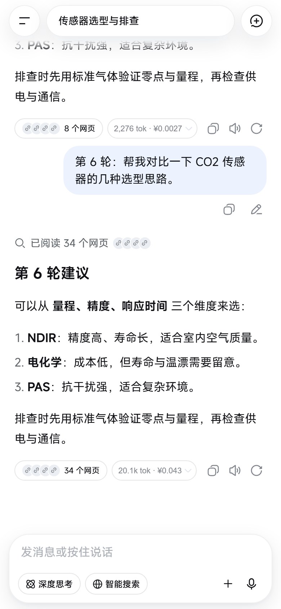

# FreeSeek 畅聊

**自带 DeepSeek API Key 的安卓聊天客户端：没有次数限制、没有每日额度、不清理你的会话，数据只存在本机。**

[](https://github.com/WikG1018/FreeSeekApp/releases) [](https://github.com/WikG1018/FreeSeekApp/releases/latest) [](LICENSE)

基于 DeepSeek 官方开源的 [chat-demo](https://github.com/deepseek-ai/chat-demo)（MIT）二次开发，界面延续官方风格，另加对话接续、人设库、用量费用看板与应用内更新。

<p>
  
  
  
  
</p>
<p>
  
  
  
  
</p>

## 为什么做这个

DeepSeek 官方 App 在算力紧张时会限制使用：每日额度、长对话不再支持、修改与重新生成的次数被卡住。FreeSeek 换个思路——**你自己带 Key，按 token 付费**，把是否继续、改几次、留多久的权力拿回自己手里。

- 不设次数上限：重新生成、修改提问都不拦
- 会话永久保存在本机 IndexedDB，不活跃也不会被清
- 数据随时导出 ZIP，换机可恢复

## 功能

| 功能 | 说明 |
| --- | --- |
| 对话接续 | 任意会话菜单选「从这里继续」，新对话自动携带它之前的上下文 |
| 人设与提示词库 | 内置写作、翻译、编程、小红书文案、头脑风暴；可自建，新对话按人设开场 |
| 用量与费用 | 每条回复的 token 与花费、会话累计、近 14 天图表、会话排行；单价按官方刊例（区分高峰/空闲） |
| 深度思考 / 智能搜索 | 与官方一致的开关，搜索结果带来源与引用 |
| 附件与文件 | 图片、文档、PDF 等，上传即进入对话上下文 |
| 语音 | 语音输入（ASR）与朗读（TTS），Android 端已适配权限 |
| 离线可用 | 全部数据在本机，除调用 DeepSeek 接口外不访问任何服务器 |
| 应用内更新 | 启动自动检查 GitHub Release，国内自动切换镜像，**提前下载好 APK**，侧边栏一键安装 |
| 深色模式 / 字体大小 | 跟随系统或手动切换；字体四档（Android 用原生 textZoom） |

## 安装

1. 到 [Releases](https://github.com/WikG1018/FreeSeekApp/releases/latest) 下载最新 `freeseek-v*-release.apk`
2. 安装时允许「未知来源」；Android 7.0 及以上
3. 首次打开会引导你绑定 API Key

> 从 v2.0 起支持应用内更新：装过一次之后，新版本会在侧边栏提示并可直接安装，不用再手动下载。

## 三步开始

1. **准备 API Key**：在 [DeepSeek 开放平台](https://platform.deepseek.com/) 注册、实名、充值，创建 API Key（应用内「API 服务」页有教学与直达按钮）
2. **粘贴 Key**：设置 → API 服务 → 粘贴保存（Key 只存在本机 localStorage）
3. **开始聊天**：可先挑个人设，再输入问题

### 把官方 App 的聊天记录搬过来

官方 App → 设置 → **数据管理** → 导出全部对话，得到 `.zip`；回到 FreeSeek → 设置 → 数据管理 → 导入历史对话。导入会整份替换本机会话，操作前会两次确认。

## 更新机制

- 启动 4 秒后自动查询 GitHub Release（结果缓存 6 小时）
- GitHub API 直连失败时，依次切换 `gh-proxy.com`、`ghfast.top`、`ghproxy.net` 镜像
- 发现新版本立即在后台下载 APK（原生流式下载、有进度），下好后在侧边栏显示「可安装」
- 点击安装会拉起系统安装器；首次需要允许「安装未知应用」

## 自行构建

需要 Node.js 22.12+、pnpm 10、JDK 21、Android SDK（compileSdk 36）。

```sh
pnpm install
pnpm build            # 产出 dist/
npx cap sync android
cd android && .\gradlew.bat assembleDebug   # macOS/Linux 用 ./gradlew
# APK: android/app/build/outputs/apk/debug/app-debug.apk
```

正式包需要签名：在 `android/keystore.properties`（已被 gitignore）里填 `storeFile / storePassword / keyAlias / keyPassword`，再执行 `assembleRelease`。

图标由 `scripts/make_icons.py` 从 `assets/icon-source.png` 生成各密度与自适应图层。

## 项目结构

```
src/                 React 客户端（组件、服务、i18n）
  components/        界面：会话、消息、设置、人设、打赏、更新…
  services/          业务：chat、usage、speech、update、settings…
android/             Capacitor Android 工程
assets/              图标与启动图源文件
docs/screenshots/    文档截图
scripts/             图标生成与冒烟脚本
```

## 隐私与安全

- 会话与附件存本机 IndexedDB，API Key 存本机 localStorage，**不上传任何第三方服务器**
- 请求只发往 `api.deepseek.com`；应用不含统计、埋点、崩溃上报 SDK
- 语音录制在本机完成编码，仅把音频提交给官方语音接口
- 导出的 ZIP 不包含 API Key

## 常见问题

**会不会有次数限制？** 没有应用层面的限制，只受 DeepSeek API 的计费与并发约束。

**上下文会不会爆？** 模型上下文 1M tokens；长会话可用「对话接续」拆成新会话，既保留上下文又不让单会话无限膨胀。

**数据会丢吗？** 存在本地存储里，卸载或清除应用数据会丢失。建议定期在「数据管理」导出备份。

**有 iOS 版吗？** 源码可直接 `npx cap add ios`；iOS 需要 Apple 签名（免费账号 7 天），不提供现成安装包。

**为什么没有账号登录？** 这是纯本地客户端，不做账号体系，也不需要你把 Key 交给任何服务器。

## 更新日志

见 [CHANGELOG.md](CHANGELOG.md)；发行与下载数据见 [docs/stats](docs/stats/README.md)。

## 许可与致谢

- 基于 [deepseek-ai/chat-demo](https://github.com/deepseek-ai/chat-demo)，MIT，见 [LICENSE](LICENSE)
- 界面字体 [MiSans](https://hyperos.mi.com/font/)（小米），许可协议见 `docs/fonts/`
- 第三方声明见 [THIRD_PARTY_NOTICES.md](THIRD_PARTY_NOTICES.md)
- 与 DeepSeek 官方无隶属关系；请遵守 DeepSeek API 服务条款使用

## 打赏

如果这个 App 帮到了你，可以在应用内「侧边栏底部 → 打赏开发者」扫码支持，或直接扫下面的码：

<p>
  
  
</p>
