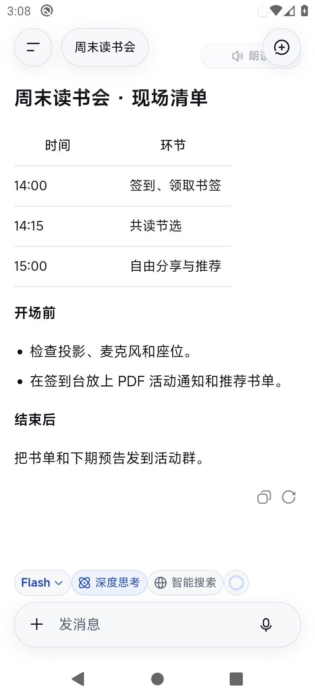
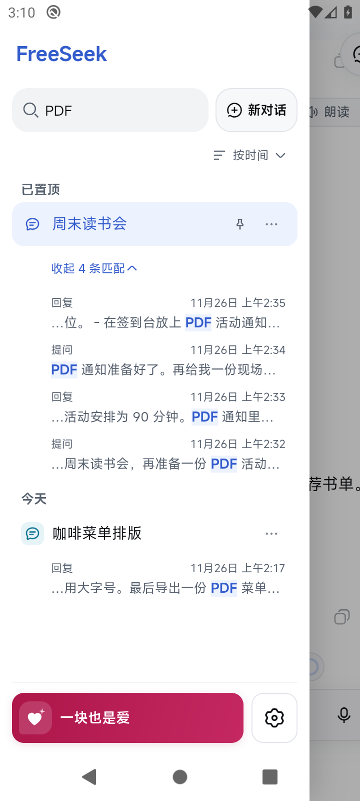
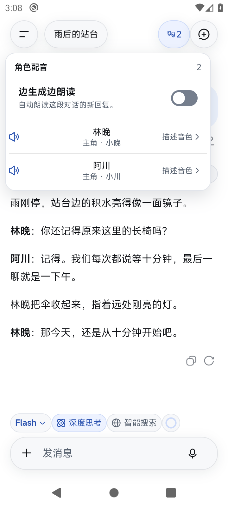
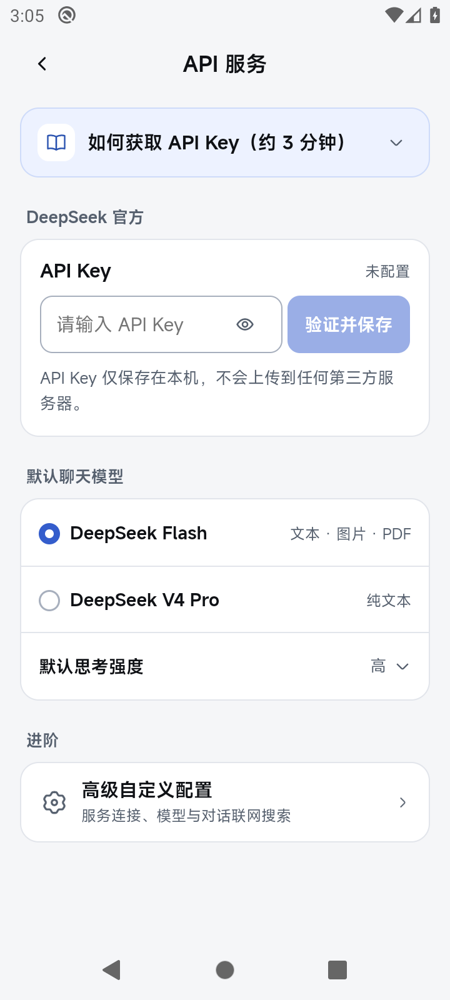
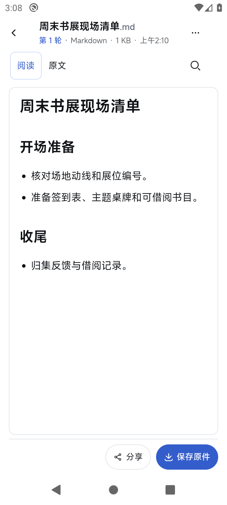
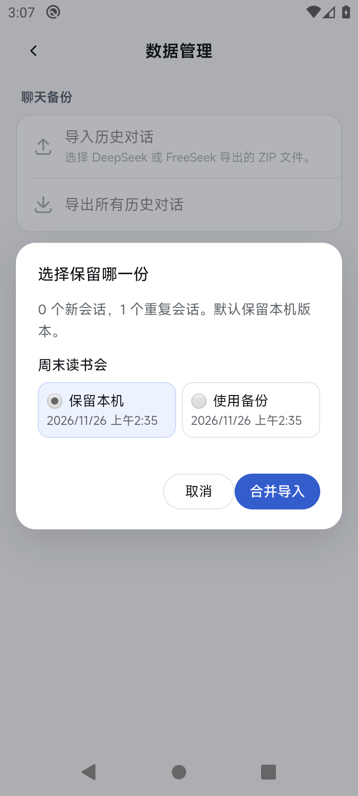
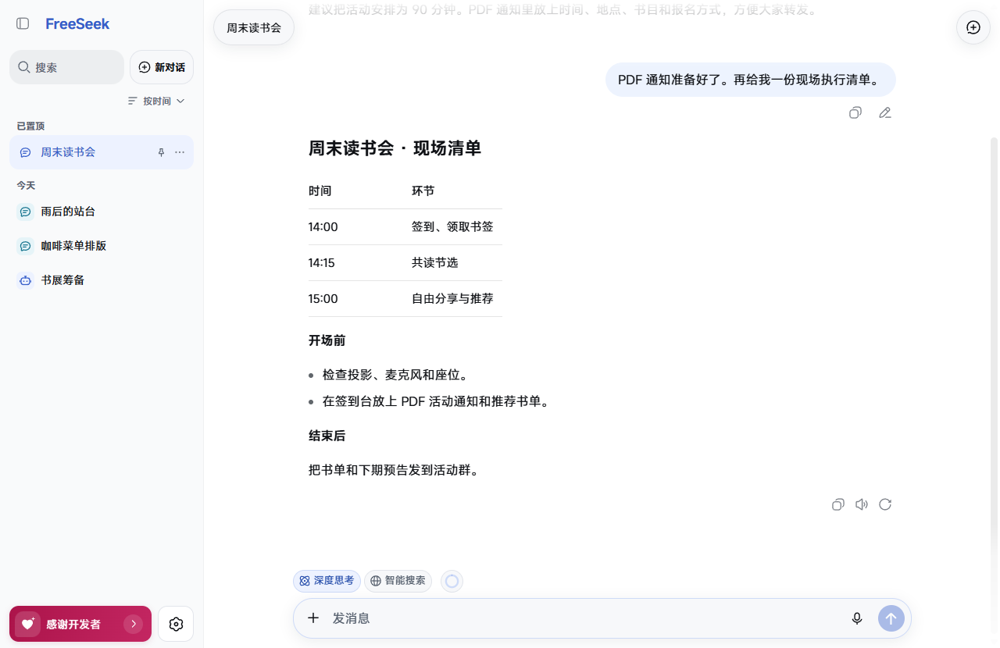

# FreeSeek 畅聊

[English](README.en.md) · [下载最新版](https://github.com/WikG1018/FreeSeekApp/releases/latest) · [打开网页版](https://wikg1018.github.io/FreeSeekApp/) · [使用指南](docs/guides/user-guide.md)

FreeSeek 是一个自带模型 API Key 的开源聊天客户端，支持 Android、Windows 和浏览器。可以接入 DeepSeek 官方模型，也可以使用自己的模型服务。聊天记录和附件保存在当前应用或浏览器中，可用 ZIP 备份迁移。

 

## 获取与安装

| 平台 | 使用方法 |
| --- | --- |
| **Android** | 在[发行页](https://github.com/WikG1018/FreeSeekApp/releases/latest)下载 `freeseek-v…-release.apk`。系统询问时允许当前应用安装 APK。安装门槛为 Android 7.0，重点兼容 Android 10–17。 |
| **Windows** | 在[发行页](https://github.com/WikG1018/FreeSeekApp/releases/latest)下载 `freeseek-v…-windows-x64-setup.exe`。安装后从开始菜单打开。 |
| **网页** | 直接[打开 FreeSeek](https://wikg1018.github.io/FreeSeekApp/)。浏览器版的接口需要允许跨域请求。 |
| **iPhone / iPad** | 用 Safari 打开同一站点，可[添加到主屏幕](docs/guides/iphone-web-app.md)。 |

已有聊天记录时，可以用新版安装包覆盖升级。换设备、重装或清除数据前，可先在「设置 → 数据管理」导出备份。[安装、校验与更新说明](docs/guides/user-guide.md#安装与更新)

## 开始使用

1. **使用 DeepSeek 聊天。** 在「设置 → API 服务」按页首教程创建 API Key，粘贴后点「验证并保存」，选择 Flash 或 V4 Pro。
2. **接入其他服务。** 在「API 服务」底部打开「高级自定义配置」，填写服务地址、密钥和模型。一个服务连接可以保存多个模型。
3. **先看旧聊天。** 在首次引导选择「把以前的聊天搬过来」，或到「设置 → 数据管理」导入 DeepSeek 或 FreeSeek 导出的 ZIP。导入和阅读旧聊天无需密钥。

[模型配置步骤](docs/guides/user-guide.md#连接模型) · [备份与换机步骤](docs/guides/user-guide.md#备份导入与恢复)

## 当前功能

| 你可以做什么 | 在哪里使用 |
| --- | --- |
| **切模型、调思考、按需联网** | API 服务可配置 DeepSeek 或自定义模型。对话偏好可显示模型和思考强度选择。开启「智能搜索」后，模型在需要时查网页并展示来源。 |
| **搜索和整理聊天** | 侧边栏搜索标题与正文，展开会话内的多条命中，逐条定位。对话可置顶、按时间或类型排序、修改提问和切换回答版本。 |
| **阅读长对话** | 输入区圆环查看预计上下文占用。侧边栏会话菜单可整理并压缩较早历史，留下近期原文继续聊。也可以在对话偏好开启自动压缩。 |
| **处理附件与成果** | 点输入框的「＋」选文件或图片。支持的内容取决于模型。图片可缩放，支持的 PDF、Word、Excel、PowerPoint 和 3D 成果可在应用内预览。 |
| **听语音和角色配音** | 麦克风转写语音，回复可朗读。配置小米 MiMo 后，在「对话偏好 → 朗读方式」选角色配音，分别管理旁白和人物音色。 |
| **使用人设、记忆和 Agent** | 设置中管理人设与自动记忆。在 Android 和网页端开启 Agent 后，可让它查资料、分步执行并生成文件。后台和工具能力随平台而异。 |
| **看用量和使用时长** | 「用量与费用」按会话、模型查看 Token、缓存命中率和费用估算。「使用时长」查看记录和会话排行。 |
| **迁移历史和反馈问题** | 数据管理支持备份和合并导入，对重复会话逐条选择版本。「关于 FreeSeek」可保存或分享诊断包。 |

## 使用截图

以下为 FreeSeek v3.1.11 Android 和 Windows 正式包的简体中文界面，使用演示会话。点图可查看原图。

| Android 对话 | 侧边栏正文搜索 | 角色配音 |
| :---: | :---: | :---: |
|  |  |  |

| API 服务 | Agent 成果 | 合并导入 |
| :---: | :---: | :---: |
|  |  |  |

*Windows 版对话和侧边栏*

## 文档与反馈

- [使用指南](docs/guides/user-guide.md)涵盖安装、API、对话、语音、备份、常见问题和数据去向。
- [开发与构建](docs/guides/development.md)包含 Web、Android 和 Windows 的构建、检查和项目结构。
- [版本记录](CHANGELOG.md)记录各版改动。应用内也可从「关于 FreeSeek」查看当前版本说明。
- [报告问题](https://github.com/WikG1018/FreeSeekApp/issues/new)时，请说明平台、版本和复现步骤。诊断包可以在「设置 → 关于 FreeSeek」保存或分享。发布前请检查其中的信息。

## 开源许可

FreeSeek 是基于 [DeepSeek chat-demo](https://github.com/deepseek-ai/chat-demo) 开发的独立客户端，使用 [MIT 许可](LICENSE)。第三方组件与 MiSans 字体分别见[第三方声明](THIRD_PARTY_NOTICES.md)和[字体许可](docs/fonts/MiSans-License.pdf)。
