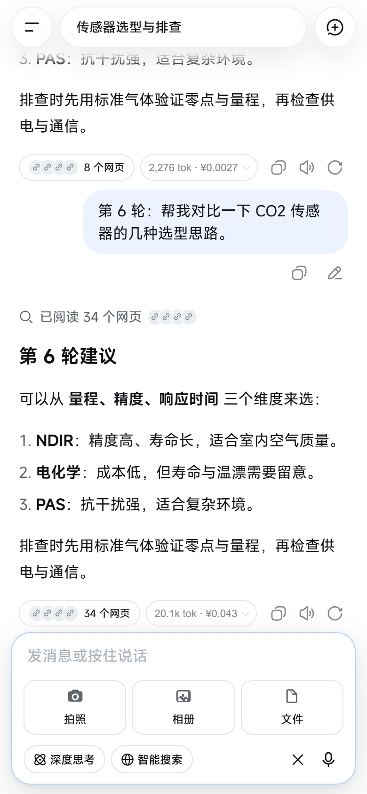
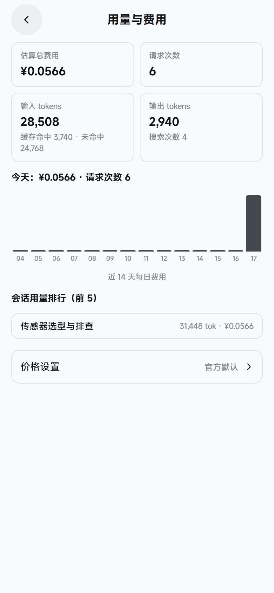
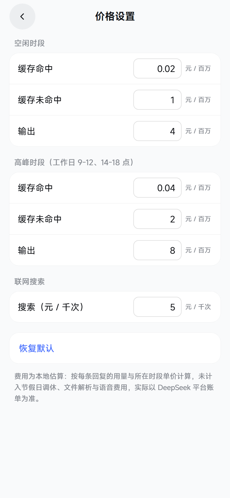

# FreeSeek

简体中文 | **English** · [Changelog](CHANGELOG.md)

**A local-first chat app that uses your own DeepSeek API key — no message limits, no daily quota, no "inactive conversation" cleanup.**

Forked from DeepSeek's official open-source [chat-demo](https://github.com/deepseek-ai/chat-demo) (MIT), with the full official-app experience and three additions:

- **Continue from any chat** — start a new conversation that inherits all context of another.
- **Persona library** — builtin & custom system prompts (writer, translator, coder, Xiaohongshu copywriter, brainstorm partner…), applied to new chats.
- **Usage & cost dashboard** — daily token usage and estimated cost with peak/off-peak DeepSeek pricing (editable).

<p>
  
  
  
  
</p>

## v1.2.2 highlights

The mobile app is the primary target of ongoing polish:

- Floating composer over the message list; header pill + round buttons unified as 44px glass capsules with correct text centering and long-title ellipsis
- Compact mobile composer: the mic and send button share one slot — mic when empty, send once you type, stop while generating; the "+" opens a camera / photos / files panel; the keyboard Enter key sends
- High-opacity glass surfaces (WebView backdrop-filter is unreliable) — text never bleeds through the composer or header
- One-line footer row per reply: web citations, token usage and copy/read-aloud/regenerate actions together, usage expands into cache/input/output details
- Pricing moved to its own sub-page (Settings → Usage → Pricing), saved per field
- Android microphone fix: `MODIFY_AUDIO_SETTINGS` declaration + native permission plugin with a "open system settings" guide when denied
- Complete motion pass: exit animations for dialogs/settings/toast, press feedback and focus rings everywhere

See the [Chinese README](README.zh-CN.md) for full documentation (installation, API key, build & signing, iOS, FAQ, third-party notices).

## Quick start

1. Create an API key at [platform.deepseek.com](https://platform.deepseek.com/) (top up a small amount).
2. Install the latest `freeseek-v*-release.apk` from [Releases](https://github.com/WikG1018/freeseek/releases/latest) (Android 7.0+; if you need voice input and are upgrading from before v1.2.0, uninstall the old app first — the permission declaration changed), or build the web version: `pnpm install && pnpm build`, then serve `dist/`.
3. Paste your key in Settings and chat. Usage is billed per token by DeepSeek — watch the built-in cost dashboard.

## Building

```sh
pnpm install
pnpm build
npx cap sync android
cd android && gradlew assembleDebug   # or assembleRelease with android/keystore.properties
```

iOS requires macOS + Xcode: run `npx cap add ios` on a Mac, or trigger `.github/workflows/ios.yml` for an unsigned archive you can sign locally. Requires Node 22.12+, pnpm 10, JDK 21, Android SDK 36.

## License

MIT — retained from the upstream project (see [LICENSE](LICENSE)). This is an independent personal client, not affiliated with DeepSeek; follow the DeepSeek API terms of service.
