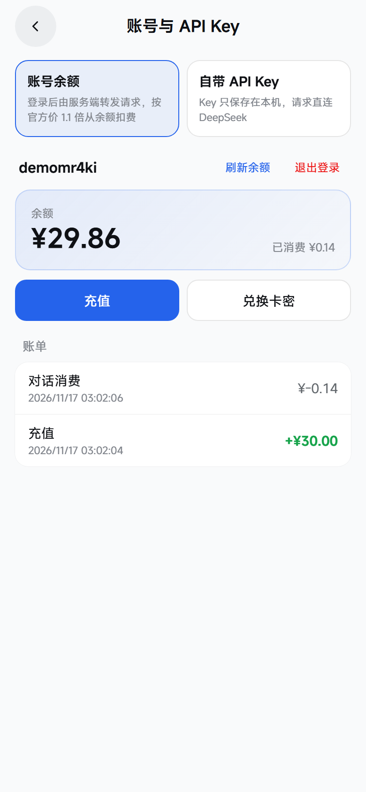
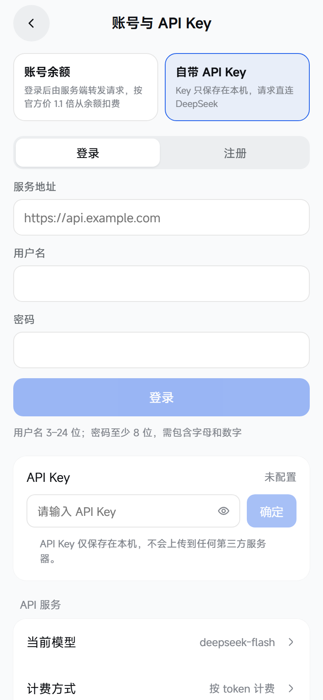
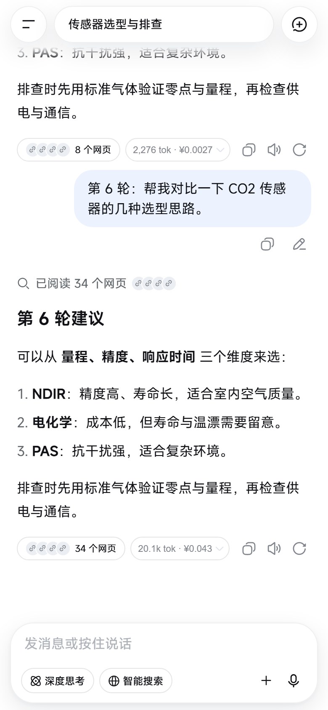
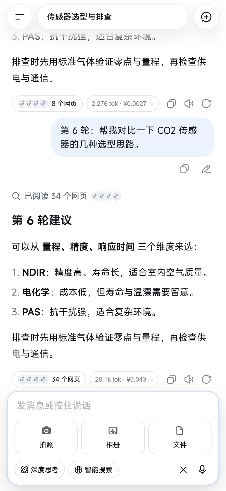
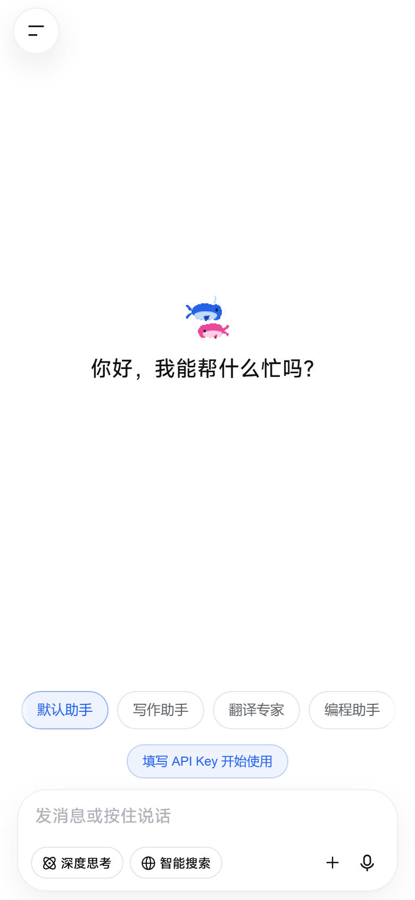
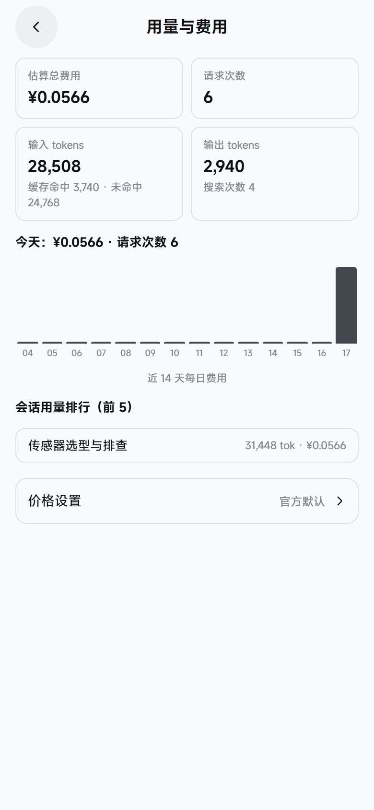
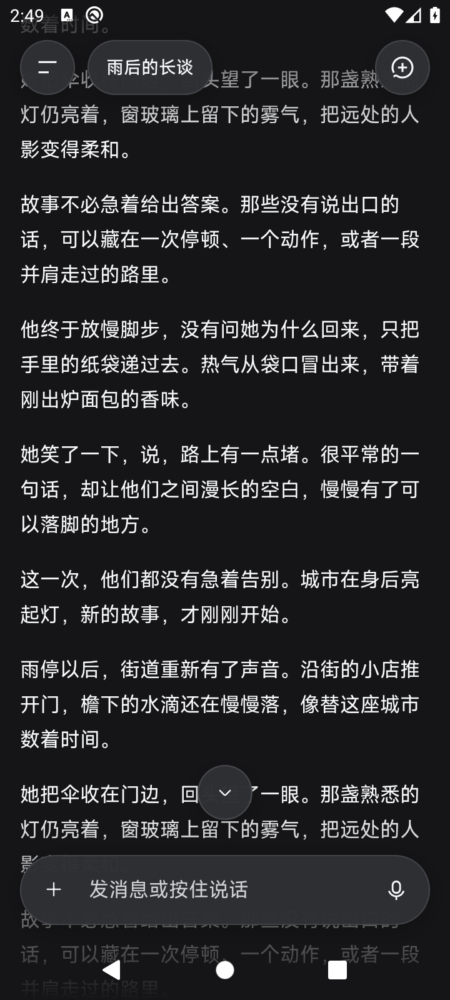
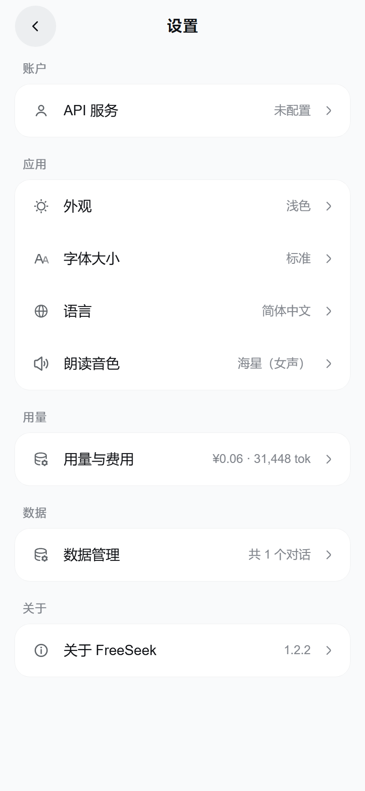

# FreeSeek

[English](README.md) | **简体中文** · [更新日志](CHANGELOG.md)

**使用自己的 DeepSeek API Key，没有次数限制、没有每日额度、没有“7 天不活跃砍会话”的本地聊天 App。**

基于 DeepSeek 官方开源的 [chat-demo](https://github.com/deepseek-ai/chat-demo)（MIT 协议）二次开发，界面与官方 App 同源，数据全部保存在你的设备上。

<p>
  
  
  
  
</p>
<p>
  
  
  
  
</p>

## 为什么做这个

2026 年 11 月 15-16 日起，DeepSeek 官方 App 与网页版因算力紧张实施限额：长对话（超过 7 天不活跃不再支持）、每日使用额度、单次输入约 4 万字上限；此前 5 月底起修改/重新生成次数也被限制到个位数。大量用户在社交平台表达了不满。

FreeSeek 的思路很简单：**自己带 Key，按 token 计费，把限制的权力拿回自己手里。** 没有次数墙、没有每日额度、会话永久保存在本地、随时导出迁移。

## 当前版本 v1.2.2

手机版为主线持续打磨，最近几版的关键变化：

- **悬浮输入栏与顶栏**：输入栏覆盖在消息之上、内容从栏底穿过；顶栏三件（菜单 / 标题 / 新对话）统一 44px 玻璃胶囊，标题垂直居中与长标题省略号已修正
- **手机输入栏精简**：麦克风与发送合并为一个位置——空输入显示麦克风，输入文字/附件后变发送，生成中为停止；「+」号展开拍照 / 相册 / 文件面板；输入法回车同样发送
- **玻璃层可读性**：WebView 毛玻璃不可靠，全部悬浮件改为高不透明度底色，正文不再透出
- **回复底部一行化**：网页引用、token 用量、复制/朗读/重新生成合并为一行小尺寸工具行（点击用量可展开缓存/输入/输出明细）
- **价格设置二级页**：设置 → 用量 → 价格设置，按空闲/高峰/搜索分组，改一项即保存
- **安卓麦克风修复**：补 `MODIFY_AUDIO_SETTINGS` 声明 + 原生权限插件，被拒时给出「去系统设置」引导
- **动效补全**：弹窗/设置/Toast 关闭有退出动画，全部可点元素有按压缩放与键盘焦点环
- **底部免责声明已移除**（原「内容由 AI 生成，请仔细甄别」）

完整历史见 [CHANGELOG](CHANGELOG.md)。
## 账号与付费（v1.3，可选）

不想自己申请 API Key 的人，可以登录你部署的服务端、用余额付费：

- **登录不是强制的**：默认仍是自带 Key 的纯本地模式；登录后切到「账号余额」即可
- **价格**：DeepSeek 官方刊例价 **×1.1**（高峰/空闲按北京时间区分），余额不足会拒绝请求并提示充值
- **充值**：手机网站支付，App 内点「去支付宝支付」直接唤起支付宝；也支持卡密兑换
- **不保存对话**：服务端只记录 token 用量与金额，不落盘任何消息内容；你的上游 Key 只存在服务端
- **语音**：账号模式下 ASR/TTS 走代理、不额外收费，但按每日次数限额防滥用

部署自己的服务端（零第三方运行时依赖，Node 22+ 即可）：

```sh
cd server
cp .env.example .env      # 本地联调：MOCK_UPSTREAM=1、PAY_PROVIDER=mock
node src/index.js         # http://127.0.0.1:8787
```

生产环境配置 `DEEPSEEK_API_KEY`、`PUBLIC_ORIGIN`、支付宝三件套（`ALIPAY_APP_ID` / 私钥 / 公钥）后，放在 HTTPS 反代之后即可；详见 [server/README.md](server/README.md)。打包 App 时可设置 `ACCOUNT_ORIGIN` 预填服务地址：

```sh
ACCOUNT_ORIGIN=https://api.your-domain.com pnpm build
```

> 计费与转售需遵守 DeepSeek API 服务条款；请自行确认账号资质与合规要求。

## 功能

**继承自官方 chat-demo 的全部能力：**

- 多会话、自动标题、重命名与删除；编辑提问、重新生成与**消息分支**（一个回答可反复生成多个版本，随时切回）
- 流式回答、深度思考、智能搜索（联网）、链接阅读与来源引用
- 附件上传（图/文/PDF 等）、语音输入、回复朗读
- Markdown、代码高亮、KaTeX 公式、Mermaid 图表
- 中英文、深浅色主题、移动端布局、历史记录 ZIP 导入导出

**FreeSeek 新增：**

| 功能 | 说明 |
| --- | --- |
| 🔄 对话接续 | 任意会话菜单里选「从这里继续」，新对话自动携带其全部上下文——官方“对话长度到顶只能割裂重开”的痛点在这里不存在 |
| 🎭 人设与提示词库 | 内置写作助手、翻译专家、编程助手、小红书文案、头脑风暴等人设，可自建；新对话按人设开场 |
| 💰 用量与费用看板 | 按天统计 token 用量与联网搜索次数，按官方刊例价（区分高峰/空闲时段）估算费用，单价可自行修改 |
| 🔓 无限制 | 提问/回答/修改/重新生成次数不限；无每日额度；不清理不活跃会话；输入长度只受 API 上下文（1M tokens）约束 |

> 提醒：无限制 ≠ 免费。FreeSeek 直连 DeepSeek 官方 API，按 token 计费从你的账户余额扣除（flash 模型空闲时段输入约 1 元/百万 tokens，详见 App 内「用量与费用」）。量大的话请留意费用看板。

## 快速开始

### 1. 申请 API Key（约 3 分钟）

1. 打开 [platform.deepseek.com](https://platform.deepseek.com/)，注册并完成实名；
2. 充值（最低充值金额以平台为准，日常聊天几块钱可用很久）；
3. 左侧「API Keys」→ 创建，复制保存（只显示一次）。

### 2. 安装

- **Android**：前往 [Releases](https://github.com/WikG1018/freeseek/releases/latest) 下载最新 `freeseek-v*-release.apk` 直接安装（允许未知来源即可）。要求 Android 7.0+。若从 v1.2.0 之前的版本升级且需要语音输入，请先卸载旧版再安装（权限声明有变化）。
- **iOS**：需要 Mac + Xcode + Apple ID（免费账号可 7 天自签，付费账号长期使用）。用 GitHub Actions 的 iOS 工作流生成工程后本地签名安装，详见 [iOS 构建说明](#ios-构建说明)。
- **网页版（免安装）**：`pnpm install && pnpm build`，把 `dist/` 部署到任意静态服务器，或直接双击 `dist/index.html`。

### 3. 使用

首次打开 → 设置 → 填入 API Key → 开始聊天。所有数据（会话、附件、Key）仅保存在本机（IndexedDB / localStorage），不会上传到任何第三方服务器；发送对话时内容仅提交给 DeepSeek API。

## 自行构建

需要 Node.js 22.12+、pnpm 10、JDK 21 与 Android SDK（compileSdk 36）。

```sh
pnpm install
pnpm build          # 产出 dist/
npx cap sync android
cd android && gradlew assembleDebug   # Windows 用 .\gradlew.bat
# APK: android/app/build/outputs/apk/debug/app-debug.apk
```

发布正式包（需先配置签名，见下）：

```sh
cd android && gradlew assembleRelease
# APK: android/app/build/outputs/apk/release/app-release.apk
```

### 发布签名（可选）

在 `android/keystore.properties`（**已被 .gitignore 忽略，严禁入库**）中填写：

```properties
storeFile=C:\\path\\to\\release.jks
storePassword=你的密码
keyAlias=你的别名
keyPassword=你的密码
```

存在该文件时 `assembleRelease` 自动使用它签名；否则输出未签名包。

### iOS 构建说明

iOS 平台的生成与签名必须在 macOS 上进行（本仓库未提交 `ios/` 目录）：

- **有 Mac**：`pnpm build && npx cap add ios`，打开 `ios/App/App.xcworkspace`，选择你的开发者团队后运行到 iPhone。
- **没有 Mac**：把仓库推到 GitHub，手动触发 `.github/workflows/ios.yml`，产出未签名 `.xcarchive` 与完整 iOS 工程；再借一台 Mac 用 Xcode 打开签名安装。免费 Apple ID 签名 7 天有效，付费账号（$99/年）可长期使用。

## 数据与隐私

- 会话与附件原件存 IndexedDB，API Key 与设置存 localStorage，全部在本机；
- 历史导入导出（ZIP）不包含 API Key；
- 不内置任何统计、崩溃上报或第三方 SDK。

## 常见问题

**Q：会不会有次数限制？**
A：没有。FreeSeek 只是 DeepSeek API 的客户端，限制只来自 API 的用量计费与并发限制，不再有 App 端的每日额度、修改次数墙或长对话清理。

**Q：对话越聊越长会不会超上下文？**
A：DeepSeek 当前模型上下文为 1M tokens。FreeSeek 的「从这里继续」可以把一个会话的上下文带入新会话，避免单会话无限增长的界面管理问题。

**Q：数据会丢吗？**
A：数据存在浏览器/WebView 的本地存储中。建议定期在「设置 → 数据管理」导出 ZIP 备份；卸载 App 或清除存储会删除本地数据。

**Q：iOS 能像安卓一样直接装 APK 吗？**
A：不能。iOS 必须经过 Apple 签名（免费账号 7 天、付费账号长期），这是系统限制，不是 App 的问题。

## 字体与第三方许可

- 界面字体为 [MiSans](https://hyperos.mi.com/font/)（小米），按《MiSans 字体知识产权许可协议》使用，本应用已在「设置 → 关于」中注明；许可原文见 [docs/fonts/MiSans-License.pdf](docs/fonts/MiSans-License.pdf)。
- 代码基于 DeepSeek 官方开源 chat-demo（MIT），详见 [LICENSE](LICENSE) 与 [THIRD_PARTY_NOTICES.md](THIRD_PARTY_NOTICES.md)。

**Q：为什么没有“账号登录”？怎么登录 DeepSeek 官方？**
A：本应用基于官方开源的 chat-demo，它本身不包含账号体系（BYOK，直接用 API Key）。官方 App 的登录是其私有账号系统（手机号等），并未开源。因此我们提供「登录 DeepSeek 开放平台」入口：用系统浏览器打开官方页面完成登录/注册，在控制台创建 API Key 后粘贴回来。应用不接触、不保存你的账号密码。

**Q：字体大小在哪些地方生效？**
A：Android App 使用原生 `textZoom`，只缩放文字、不改变布局，触控尺寸保持不变；网页预览为整体等比缩放。

**Q：token 用量在哪里看？**
A：每条回复底部的工具行直接显示本条「token · 费用」，点击展开缓存命中/未命中/输出明细；会话标题胶囊显示该会话累计；设置 → 用量与费用 看每日统计、会话排行与价格设置（价格在独立的二级页面里改）。

## 与官方 chat-demo 的关系 & 许可

本项目 fork 自 [deepseek-ai/chat-demo](https://github.com/deepseek-ai/chat-demo)（MIT License），感谢 DeepSeek 开源。依 MIT 协议分发时保留原许可证（见 [LICENSE](LICENSE)，构建产物中亦会复制到 `dist/LICENSE`）。FreeSeek 为个人自用客户端，与 DeepSeek 官方无隶属关系；请遵守 DeepSeek API 服务条款使用。
